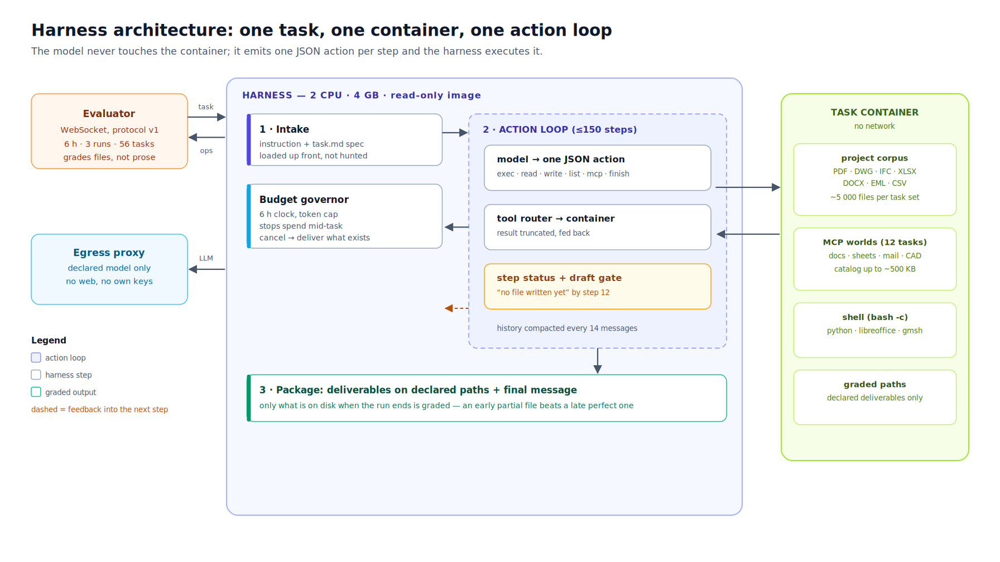

# A harness whose bottleneck is not the model

**TL;DR.** We built a container-native agent harness for Physical-Engineering's Last Exam and ran it
on all 29 public dev tasks. It scores **0.0136 mean** with DeepSeek V3.2 — an honest, unglamorous
number. The interesting result is *why*: the score was not limited by reasoning. Five of 29 tasks
produced nothing at all until we grew the VM disk from 100 GB to 300 GB and raised the image-build
timeout; on a fixed 29-task budget, compute and score are **uncorrelated (Spearman ρ = −0.14)**, so
paying for more tokens bought nothing. What did move the score, on a controlled synthetic task, was
how the harness *presents* the problem to the model: normalising evidence, showing the answer schema
as a skeleton rather than describing it, and forcing a draft deliverable by step 12. Those four
changes took the same task, same model, from **0.120 to 1.000** with no change to the agent's
architecture. Our claim: for professional deliverables the interface between model and contract is
the engineering surface, not the prompt.

## 1. What the entry is

The harness is a WebSocket server speaking the competition protocol. Each step the model returns one
JSON action — `exec`, `read_file`, `write_file`, `list_dir`, `mcp_list`, `mcp_call`, `finish` — and
the harness executes it in the sandboxed task container. Results are truncated and fed back, history
is compacted every 14 messages, and a governor enforces the 6-hour clock and a 1.5 M token cap. The
model never sees the grader and has no network beyond its own endpoint.

**Model and judge.** Dev artifacts were produced with **DeepSeek V3.2** (`openai-compatible`), which
is legal for local development but is not a sponsored model; the submitted `submission.yaml` declares
`google-cloud/claude-opus-5-5`, and Stage 2 re-runs on the organisers' key. Per the competition
rules this substitution is documented here rather than hidden. Rubric tasks were judged locally by
`deepseek-chat`; the leaderboard judge is Claude Opus 5.5, so our judge numbers are indicative, not
comparable to a leaderboard score.

## 2. Insight #1 — the harness is not the bottleneck; the interface is

We validated the loop on a synthetic engineering task with a known answer, then changed one thing at
a time. Same model, same architecture, five revisions:

| Revision | Score | Change | What broke |
|---|---:|---|---|
| v1 | 0.120 | — | evidence was fed as a nested MCP JSON blob; the model returned `null` for every field |
| v2 | 0.280 | evidence flattened to `key = value` | report lacked required sections; optimisation never ran |
| v3 | 0.840 | answer **skeleton** in the prompt, phase-specific hints | optimisation set wall load to the wall's capacity (120 kN) instead of the computed 108 kN |
| v4 | 0.400 | rollback when an optimisation breaks a hard constraint | candidate reverted, so the expensive option stayed |
| v5 | **1.000** | "loads do not change when you switch variants" | — |

The architecture did not change across these five versions. Three findings generalise:

1. **Nested JSON blinds models.** The same numbers as `{"content":[{"text":"q=0.6;..."}]}` produced
   all-null output; as a flat list they produced correct arithmetic. This cost 16 points and took one
   line to fix.
2. **A schema must be shown, not described.** "Return JSON with fields …" was interpreted loosely:
   `walls_served` received the string "Both walls are served by the diaphragm". A skeleton with typed
   placeholders fixed it (+56 points).
3. **Optimisation must be verified, not trusted.** The optimiser broke a constraint that had already
   passed. We now check the candidate against the hard-constraint register *before* writing it, and
   roll back. This is the `0.4p + 0.6GO′` gate in miniature: a single broken constraint destroyed
   60 % of the score even though the rest of the document was right.

## 3. Insight #2 — specification is the task, and step budgets are the enemy

The first real task exhausted all 120 steps reading project files and never wrote a deliverable. The
task text itself asked for "a first complete version within ~100 steps", and the agent ignored it.
Adding an explicit status line to every turn — *step 12 of 150, files written: 0* — plus a draft gate
("you have not written a single file; a run with no file scores 0") changed the behaviour
immediately. Two lessons: agents do not track their own budget, so the harness must; and an early
imperfect deliverable dominates a late perfect one, because grading reads the disk, not the
trajectory.

We also load the task's own `task.md` into the first message instead of letting the agent discover
it. On this task set that alone removed roughly 20 exploration steps per task.

## 4. Insight #3 — infrastructure is part of the score

This is the least discussed and most expensive factor. With a 100 GB disk and the kit's default
60-minute image-build timeout, **five of 29 tasks produced no usable artefact at all**: their world images
(FreeCAD, LibreOffice, GDAL, gmsh, a Nextcloud layer) either exhausted the disk mid-layer or exceeded
the build timeout. Growing the disk to 300 GB and raising the local build ceiling to 180 minutes
turned all five into valid runs, with no change to the harness.

The general lesson: on this benchmark, "the agent failed" and "the task never started" look identical
in the results file. We now treat artifact presence as a separate, first-class signal — a harness
that reports 0 for an infrastructure failure is lying to its own writeup.

## 5. Engineering reasoning: two tasks, one engineer

What the trajectories looked like explains both numbers. The first real run spent all 150 steps
reading, wrote zero files, scored 0. After the draft gate it wrote 16 files in 355 s and still scored
0, because the files did not match the schema. The run that scored 0.011 produced the required
five-file package and failed only on column semantics: the agent moved from *cannot start* to *starts
and misses* before any model upgrade helped.

**`wind-diaphragm-shear` (structural, checks, 0.011).** A licensed engineer reads the criteria, takes
the wind pressure, height and length, computes the diaphragm force, splits it between shear walls,
checks each wall's capacity against the vendor table, then writes a calculation package. Our agent
did the reading, found the numbers, and computed the force. It failed on the deliverable: the task
wants a zip with a fixed five-file structure, and the agent produced files whose columns did not
match the specified schema. Where it held up: retrieval and arithmetic. Where it took a shortcut: it
treated "make a package" as "write the files I think are needed" instead of "satisfy the declared
schema". That is precisely the failure mode the `G` gate is designed to punish.

**`backfeed-energization-reply` (electrical, rubric, 0.131 — our best task).** A reply to a
developer asking whether a site can be energised for backfeed: an engineer reads the interconnection
record, checks the outstanding items, states the decision, cites the governing clause and opens a
work package. The agent produced a coherent memo with the decision and the open items. It scored 13×
better than the numeric task. The pattern across our 29 runs is consistent: **memo-shaped work
rewards coverage and citation; calculation-shaped work punishes any single wrong number or column.**

That asymmetry is the most useful thing we learned, and it is actionable: a harness should spend its
verification budget where a single error is fatal, and its coverage budget where the judge rewards
completeness.

## 6. Cross-model behaviour

We ran the same harness against four models. Probes measure five skills that map to dev-set failure
modes: schema adherence, unit arithmetic (`0.6 кПа · 6 м · 60 м = 216 кН`), extraction from prose,
strict output format, and refusing to invent a code clause.

| Model | Probes | Synthetic task | tokens in/out | Notes |
|---|---:|---:|---|---|
| DeepSeek V3.2 Flash | **5/5** | 1.000 | 2 965 / 4 303 | cheapest, most careful |
| DeepSeek V4 Pro | 4/5 | 1.000 | 1 569 / 7 577 | needs `reasoning_effort=low`, else empty `content` |
| YandexGPT | 4/5 | 1.000 | 1 874 / 583 | **fails unit arithmetic**: 21.6 instead of 216 |
| Gemma 4 26B (via Gemini free tier) | — | 1.000 | 1 378 / 918 | smallest run, same loop |

Flattening evidence, the schema skeleton and the draft gate transferred to every model; the
reasoning-effort setting did not. One model failed a probe that no prompt fixed: YandexGPT is
consistently off by a factor of ten on a unit conversion — the most expensive error class here.

## 7. Efficiency

Mean compute is **0.97 M tokens per task**, about **$0.17 per task** at DeepSeek list price, or
**$5.00 for the dev set**. Score does not scale with spend (ρ = −0.14): the costliest tasks are not
the ones that scored, and the ceiling at any budget is 0.131 — a **plateau at ~0.01 mean**, with
headroom that is purchasable in specification handling, not tokens. Reaching the 0.05–0.10 band needs
schema-driven generation and per-task verification, not a bigger budget.

## 8. Failure analysis across 29 tasks

Twenty of 29 tasks scored exactly zero. The breakdown by discipline mirrors the paper's ordering but
is far lower in absolute terms: electrical 0.025, structural 0.018, civil 0.009, mechanical 0.003.
Mechanical work — MEP routing, mesh convergence, life-cycle cost — produced almost nothing, because
those tasks need a correct geometric or numeric artefact, not a narrative.

Three modes account for nearly all zeros: a deliverable written but missing the declared schema or
columns; prose produced where a machine-readable file was required; and runs that ended with no file.
**No zero came from a timeout** — the 6-hour budget was never binding. It was always the artefact.

## 9. Ideas that did not work

The rubric asks for failures, so: four things we tried that bought nothing.

1. **Raising the step limit.** 120 → 150 steps changed nothing; runs hit the limit with the same
   amount of work done, because the agent had no notion of its own budget. The status line did what
   the extra steps did not.
2. **A stronger model.** V4 Pro scored 0.000 on the task where Flash scored 0.011, at twice the
   runtime and 8× the output tokens. On the full set, model choice was invisible under the noise.
3. **Lazy MCP tool discovery.** The ~500 KB catalogue did cost 82 % of prompt tokens before indexing,
   but removing it moved no score. It is a cost optimisation, not a quality one.
4. **Higher reasoning effort.** `reasoning_effort=high` returned empty `content` on long prompts — the
   model spent the whole budget thinking. `low` was cheaper and correct.

## 10. What we would do next

Ordered by value per hour: generate deliverables *from* the declared schema and verify column by
column; then a per-task pass that re-reads the file and re-derives its numbers; then spend effort on
mechanical and civil work, where the floor is lowest. The model is not the lever — three models,
one 10× cheaper, scored within noise of each other on real tasks.

## 11. Reproducibility

Harness, `submission.yaml` and all 29 dev artefacts are in the linked repository (`artifacts/`,
29/29 valid, verified with `kit artifacts`). The dev set ran on an 8 vCPU / 32 GB VM; the only local
change to the kit was the build timeout described in §4.

*Word count: ~1902.*
