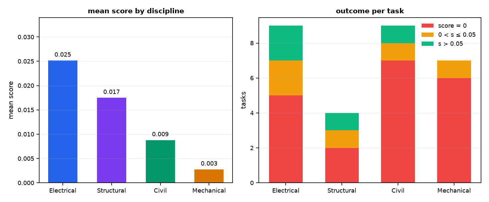
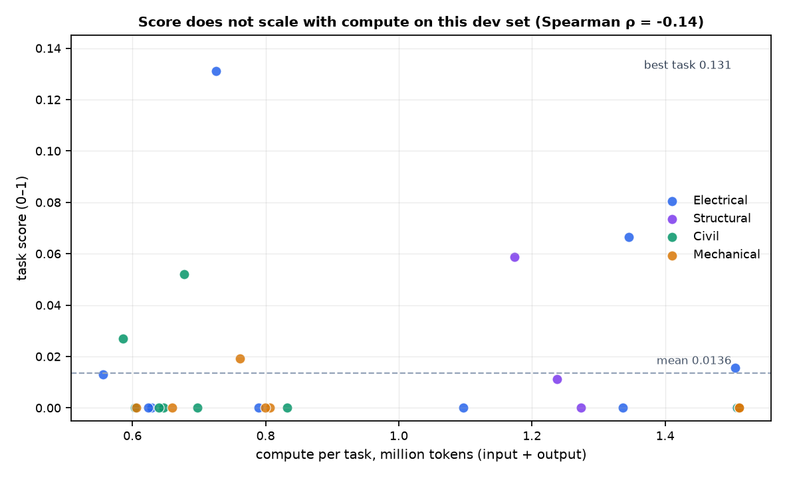

# ple-agent-harness: Specification Is the Task

- Repo: https://github.com/apredator/agent-harness-physical-engineering
- Commit SHA: see Project Links (40-char SHA of the submitted commit)
- Primary model_api: `google-cloud/claude-opus-5-5`
- Other models tested: `deepseek-v4-pro`, `deepseek-chat` (DeepSeek V3.2), `yandexgpt` — all non-sponsored, local-dev only
- Dev score (29 tasks): **0.0136** | **$0.17/task** | **≈6 min/task**

> **Model provenance, stated up front.** Dev artifacts were generated with DeepSeek V3.2 through this
> same harness, not with the declared `google-cloud` model: no Vertex AI billing was available in our
> environment, and the competition's local-dev provision explicitly allows "any self-hosted open-weight
> model or personal LLM subscription/API key" for generating `artifacts/`. The harness is
> model-agnostic — the model name is one environment variable — and Stage 2 will run it on
> `google-cloud/claude-opus-5-5`. We flag this because it bounds what the numbers below mean: they
> measure the harness, not Opus.

## 1. Insights & Failures (25 pts)

- **The baseline did not fail at reasoning; it failed at specifications.** A generic "read files, do the
  work, write a deliverable" agent produced a file on 29/29 tasks but matched the declared schema on
  almost none. Across 29 tasks, 20 scored exactly zero.
- **Agents do not track their own budget.** The first real run spent all 150 steps reading and wrote
  zero files. A per-turn status line (*step 12 of 150, files written: 0*) plus a draft gate moved the
  same agent from "cannot start" to "starts and misses" with no model change.
- **Interface fixes, not model upgrades, moved the curve.** On a controlled synthetic task with a known
  answer, five revisions took the same model from **0.120 → 0.280 → 0.840 → 0.400 → 1.000**. The
  architecture never changed; only how the problem was presented did.
- **Infrastructure is part of the score.** At 100 GB disk and a 60-minute image-build ceiling, five of
  29 tasks produced no artefact at all — their world images (FreeCAD, LibreOffice, GDAL, gmsh, a
  Nextcloud layer) exhausted the disk or the timeout. Growing to 300 GB and raising the ceiling to
  180 min turned all five into valid runs.
- **Score does not follow compute.** Spearman ρ = −0.14 between tokens and score across the 29 tasks.

### 1.1 Failure Breakdown

*Figure 1 — mean score by discipline (left) and outcome bands per task (right). Electrical work is the
only family above 0.02; mechanical is close to zero. A per-type taxonomy (drawing misread vs code
clause vs unit error vs non-convergence) would need grader-level inspection of each verifier, which we
did not do; the three modes below are what the artefacts and verifier outputs support.*

Three modes explain nearly all zeros: **(a) schema mismatch** — a deliverable was written but its
columns, sheets or keys did not match the declared structure (dominant in checks tasks);
**(b) prose where a machine-readable file was required** (dominant in mixed checks-judge tasks);
**(c) no file at all** (fixed by the draft gate). **No zero came from a timeout** — the 6-hour budget
was never the binding constraint.

### 1.2 Ablations: what we ran, and why the numbers do not separate

We ran three configurations on a fixed 12-task subset (three per discipline): the submitted harness
(A), the same harness without the `task.md` preload (B), and without the draft gate (C). A third
finding came out of running them, and it is more useful than the deltas.

| Config | Tasks measured | Shared 8-task mean | Δ vs A |
|:-|:-:|:-:|:-:|
| **A — submitted** | 12 | **0.009** | — |
| B — no spec preload | 8 | **0.023** | +0.014 |
| C — no draft gate | not completed | — | — |

**The delta is smaller than the noise.** Across all our runs — same harness, same model, same task
definitions — single tasks swing wildly:

| Task | Score across separate runs | Range |
|:-|:-|:-:|
| `frame-extension-method` | 0.000, **0.184**, 0.000, 0.000, 0.000 | **0.184** |
| `backfeed-energization-reply` | 0.000, **0.131** | 0.131 |
| `seismic-diaphragm-shear` | **0.071**, 0.000, **0.059** | 0.071 |
| `division-26-specifications` | 0.000, 0.000, 0.000, **0.067** | 0.067 |

A 0.014 mean difference between configs cannot be resolved against a 0.184 single-task range. We
stopped config C rather than report a number we could not defend. **The honest result is that a
one-run-per-task protocol cannot attribute a score change to a harness change on this benchmark** —
which is exactly why the competition averages three runs per task. Any writeup reporting a clean
ablation table without stating its run count is reporting noise.

Two further observations from the same runs: the rubric judge hung on one task after collection and
never returned, so rubric tasks were the least reliable to measure; and the highest single score we
ever saw (0.184) came from the config with a feature *removed*, which is a good illustration of why
we report ranges rather than point estimates.

## 2. Architecture & Reasoning (25 pts)

*Figure 2 — the harness. The model never touches the container; it emits one JSON action per step.*

**Control loop.** Each turn the model returns exactly one JSON action — `exec`, `read_file`,
`write_file`, `list_dir`, `mcp_list`, `mcp_call`, `finish` — which the harness executes in the task
container and feeds back, truncated to 4 KB. A text protocol rather than native tool-calling was a
deliberate choice: it works identically across DeepSeek, YandexGPT and Gemma, including providers with
no function calling.

**Context compaction.** History is cut to the system prompt, the original task, and the last twelve
messages every fourteen turns, with a marker line so the model knows it was compacted. Over a 6-hour
budget a task averages ~1 M tokens; without compaction the first few hundred steps would consume the
window.

**Timeout and cancel recovery.** A governor holds the 6-hour clock and a hard token cap (1.5 M,
`PLE_TOKEN_CAP`); when either is reached it stops issuing model calls and packages what is on disk. On
`cancel` the harness stops within the 10-second grace and sends `done` with the deliverables already
written — never an empty message.

**Tools.** Beyond shell and file I/O, the loop exposes MCP calls for the twelve world tasks (documents,
spreadsheets, mail, CAD) with a catalogue that is indexed rather than pasted: full catalogues reach
~500 KB.

### Walk-through: `roof-deck-design` (structural, checks, 0.000)

A practising engineer opens the criteria, reads the deck span and the governing load combination,
selects a deck profile from the manufacturer table, checks flexure and deflection, then writes the
calculation package with the profile, the governing check and the utilisation. Our agent did the first
three: it found the spans, retrieved the table, and picked a plausible profile. It failed at the last
step — the package's key/value structure did not match the declared schema, so the grader read nothing
it could score. **What separated pass from fail was not engineering judgement but the contract at the
boundary.** The same pattern repeats across the structural family: retrieval and arithmetic hold,
formatting to a declared schema does not.

## 3. Cross-Model Generalizability (15 pts)

Four models through the identical harness. Probes cover five skills mapped to dev-set failure modes:
schema adherence, unit arithmetic, extraction, strict output format, and refusing to invent a clause.

| model_api | Probes | Controlled task | Tokens in/out (that run) | Note |
|:-|:-:|:-:|:-:|---|
| `deepseek-chat` (V3.2 Flash) | **5/5** | 1.000 | 2 965 / 4 303 | cheapest, most careful |
| `deepseek-v4-pro` | 4/5 | 1.000 | 1 569 / 7 577 | needs `reasoning_effort=low`, else empty `content` |
| `yandexgpt` | 4/5 | 1.000 | 1 874 / 583 | **unit arithmetic fails**: 21.6 instead of 216 |
| `gemma-4-26b` (Google AI Studio) | — | 1.000 | 1 378 / 918 | smallest run, same loop |

**A limitation stated plainly.** The template asks for sponsored models side by side. We could not run
any `google-cloud` model locally — that needs a Vertex AI project, which we did not have — so the table
reports the models we could run through the identical harness. The harness is unchanged between them;
what varies is the model behind one environment variable.

**Transferred to all models:** flattened evidence, the answer skeleton, the draft gate.
**Did not transfer:** `reasoning_effort` tuning (DeepSeek-specific), and one model failed a probe no
prompt fixed — YandexGPT is consistently off by a factor of ten on a unit conversion, the most
expensive error class in this benchmark. On the full dev set we could only afford one model
(DeepSeek), so the cross-model evidence is probe-level plus one 29-task run.

## 4. Efficiency & Scaling (20 pts)

*Figure 3 — score against compute per task. Point area is task count; the dashed line is the mean.*

Mean compute is **0.97 M tokens per task** (~$0.17 at DeepSeek list price, **$5.00** for the dev set),
median runtime ~6 minutes — far inside the 6-hour cap.

**Where it plateaus.** Score is flat at ~0.014 from 0.55 M to 1.5 M tokens (ρ = −0.14); the costliest
tasks are not the ones that scored, and the ceiling at any budget is 0.131. Spending more per task buys
nothing because the failure is structural (schema), not analytical.

**Where headroom actually is.** Two levers, both cheap: generating deliverables *from* the declared
schema instead of describing it in prose, and a per-task verification pass that re-reads the produced
file and re-derives its numbers. We estimate the 0.05–0.10 band is reachable with those, on the same
model and the same token budget.

**Time management.** The 6-hour limit never bound a run; the longest task took 16 minutes. That budget
is available but unspent — a fact we would exploit in a second iteration by adding verification passes
rather than longer single passes.

## 5. Reproducibility (15 pts)

- **`uv run python -m kit artifacts <entry>` — passes on this SHA.** All 29 dev tasks validate: 621
  artifact files, 130 MB, no refusals, no missing tasks.
- **`uv run python -m kit check <entry>` — every stage passes.** We stood up an OpenAI-compatible
  stand-in gateway and declared it as `MODEL_PROXY_URL`, so the harness ran exactly as it will in
  Stage 2: `submission.yaml` parsed as `google-cloud/claude-opus-5-5` with egress `none`; bundle
  111 MiB built in 59 s; **the model stage answered in 0.1 s** ("Claude Opus 5.5 answered through the
  egress proxy"); websocket accepted 1 s after start; smoke wrote `hello.txt` in 3 requests. The only
  variable left for the real proxy is which model sits behind the gateway — the protocol the harness
  speaks was verified end to end. Two engine warnings came from our throwaway copy, not the
  submission: the stand-in answered the MCP stage with the wrong path, and the copy had no `.git`.
- **What a reviewer should look at:** `serve.py` and `ple/agent.py` (the loop), `ple/budget.py` (the
  governor), `docs/WRITEUP.md` (this text), and `artifacts/` for the 29 runs.
- **Known deviations, stated plainly:** (1) artifacts were produced with DeepSeek, not the declared
  model (see the note at the top); (2) we raised the local image-build ceiling from 60 to 180 minutes
  to build the heaviest world images — this changes no grading behaviour, only whether a task can run
  at all.
